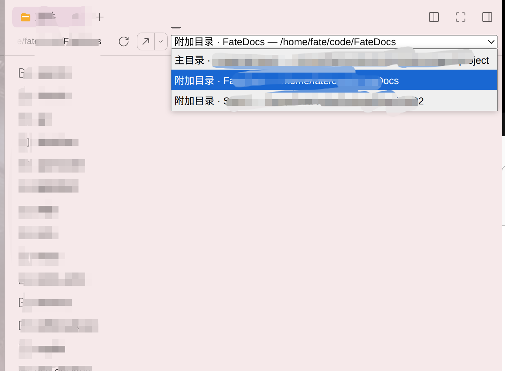
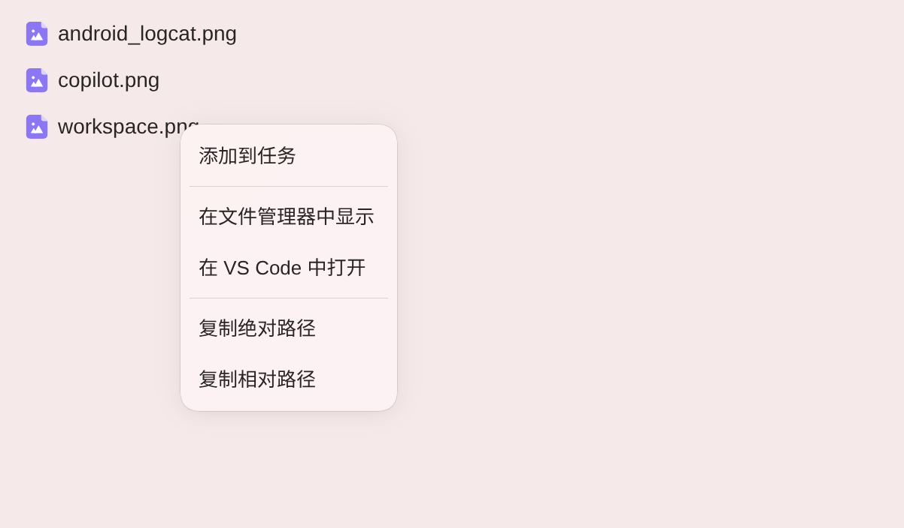
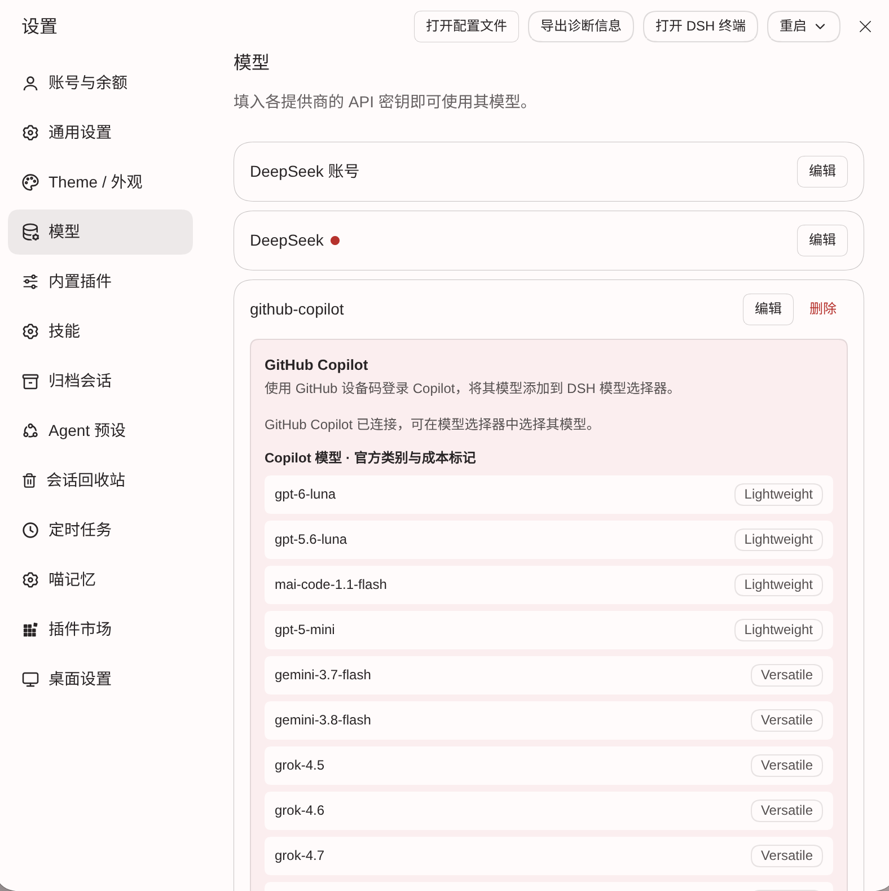
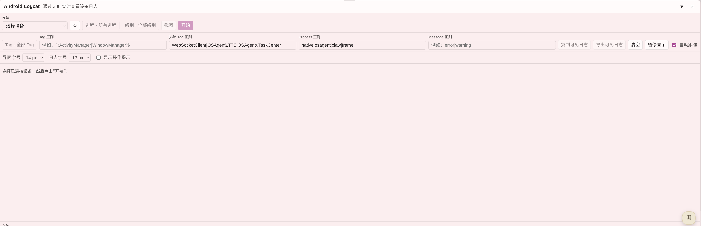

# Additional Features on `fate-dev`

This README documents only the additions maintained on the `fate-dev` branch beyond upstream DSH Desktop; it omits the general upstream product overview. [中文](README.md)

## Multi-directory workspaces

Keep the primary directory as the workspace identity and session working directory while attaching additional source directories for browsing in Files. Switching the Files browser root does not change the session working directory. Windows currently supports only the primary directory.

## Files tree shortcuts

File and directory context actions can reveal an item in the system file manager, open it in VS Code, copy its absolute or relative path, or insert a workspace reference into an Agent conversation. Dragging files or folders inserts structured workspace references without uploading file contents.

## GitHub Copilot sign-in and model integration

Sign in to Copilot with GitHub device-code authorization and add the available Copilot models to the DSH Desktop model picker.

## Android Logcat integration

Select an Android device through adb and inspect its live logs. Filter by process, Tag, excluded Tags, or message regex, and pause/resume display, copy or export visible logs, or capture a device screenshot.

---

Screenshots referenced on this branch are stored in [`dsh-plugin-desktop/docs/screenshots/`](dsh-plugin-desktop/docs/screenshots/).
