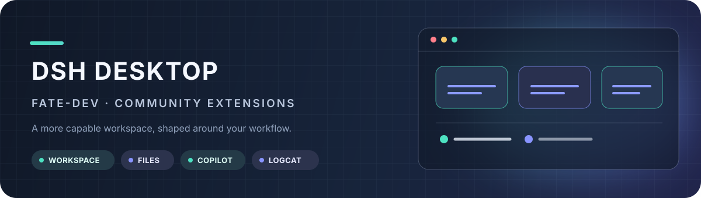
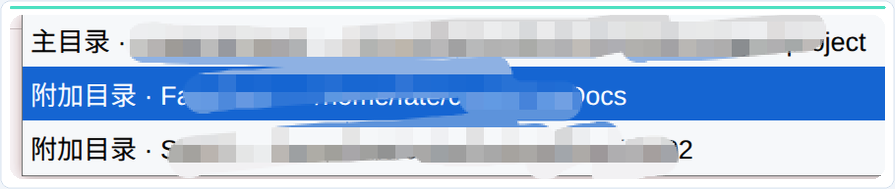
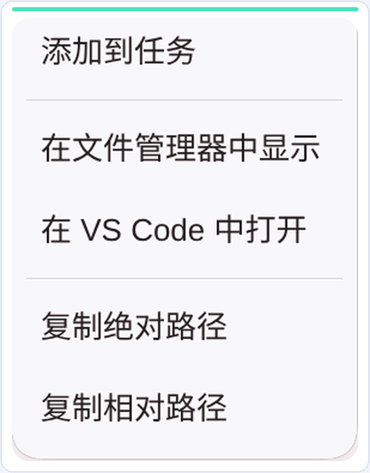
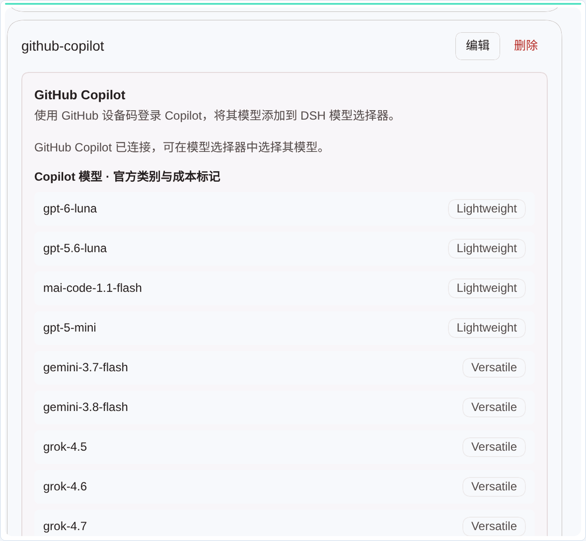

<h1 align="center">fate-dev · 为工作流而扩展</h1>

这里只展示 fate-dev 相较上游 DSH Desktop 增加的功能；上游产品介绍请见 <a href="https://github.com/anywhere-labs/dsh-desktop">上游项目</a>。 <a href="README.en.md">Read in English</a>

<strong>多目录工作区</strong>　·　<strong>文件树快捷操作</strong>　·　<strong>GitHub Copilot</strong>　·　<strong>Android Logcat</strong>

---

## 多目录工作区

让多个代码目录在同一个工作区中触手可及：主目录继续决定工作区身份与会话工作目录，附加目录可在文件浏览器中随时切换。浏览位置变化不会悄悄改变 Agent 的会话上下文；Windows 暂仅支持主目录。

## 文件树快捷操作

从文件树直接进入常用操作：在系统文件管理器中定位、用 VS Code 打开、复制绝对或相对路径，或将文件/目录作为工作区引用插入 Agent 对话。拖放传递的是结构化引用，不会把文件内容上传到对话。

## GitHub Copilot 登录与模型接入

使用 GitHub 设备码完成授权，再从 DSH Desktop 的模型选择器中选用可用的 Copilot 模型；账号连接状态和模型列表集中显示在模型设置中。

## Android Logcat 集成

在桌面端通过 adb 选择设备并查看实时 Logcat。按进程、Tag、排除 Tag 和消息正则收窄日志；暂停/继续显示、复制或导出当前可见内容，并可直接抓取设备截图。

## Ubuntu 安装包

以下为 fate-dev 构建，前往 [GitHub Releases](https://github.com/FateFeng/dsh-desktop/releases/tag/v2.0.17-fate-dev) 下载 Ubuntu x64 安装包：

| 版本 | AppImage | Debian / Ubuntu |
| --- | --- | --- |
| Stable 2.0.17 | [下载](https://github.com/FateFeng/dsh-desktop/releases/download/v2.0.17-fate-dev/DSH-Desktop-2.0.17-x86_64.AppImage) | [下载](https://github.com/FateFeng/dsh-desktop/releases/download/v2.0.17-fate-dev/DSH-Desktop-2.0.17-amd64.deb) |
| Beta 2.0.17-beta.1 | [下载](https://github.com/FateFeng/dsh-desktop/releases/download/v2.0.17-fate-dev/DSH-Desktop-Beta-2.0.17-beta.1-x86_64.AppImage) | [下载](https://github.com/FateFeng/dsh-desktop/releases/download/v2.0.17-fate-dev/DSH-Desktop-Beta-2.0.17-beta.1-amd64.deb) |

---

原始界面截图位于 <a href="dsh-plugin-desktop/docs/screenshots/">dsh-plugin-desktop/docs/screenshots/</a>；README 使用的裁切与配色版本位于 <a href="assets/readme/">assets/readme/</a>。

