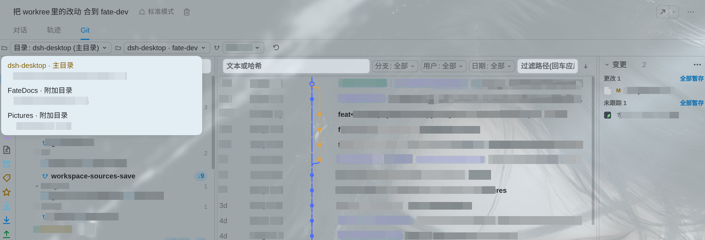

<h1 align="center">fate-dev · 为工作流而扩展</h1>

这里只展示 fate-dev 相较上游 DSH Desktop 增加的功能；上游产品介绍请见 <a href="https://github.com/anywhere-labs/dsh-desktop">上游项目</a>。 <a href="README.en.md">Read in English</a>

<strong>多目录工作区</strong>　·　<strong>文件树快捷操作</strong>　·　<strong>GitHub Copilot</strong>　·　<strong>Android Logcat</strong>　·　<strong>Git Review</strong>

---

## 多目录工作区

让多个代码目录在同一个工作区中触手可及：主目录继续决定工作区身份与会话工作目录，附加目录可在文件浏览器中随时切换。浏览位置变化不会悄悄改变 Agent 的会话上下文；Windows 暂仅支持主目录。

## 文件树快捷操作

从文件树直接进入常用操作：在系统文件管理器中定位、用 VS Code 打开、复制绝对或相对路径，或将文件/目录作为工作区引用插入 Agent 对话。拖放传递的是结构化引用，不会把文件内容上传到对话。

## Git Review 与代码审阅

Git Review 按当前会话展示已提交的变更，并支持在多个已授权工作区根之间切换。审阅目录和 Git 面板彼此独立，界面中的本地路径与仓库信息已做脱敏处理。

<table>
  <tr>
    <td width="50%"></td>
    <td width="50%"></td>
  </tr>
</table>

## GitHub Copilot 登录与模型接入

使用 GitHub 设备码完成授权，再从 DSH Desktop 的模型选择器中选用可用的 Copilot 模型；账号连接状态和模型列表集中显示在模型设置中。

## Android Logcat 集成

在桌面端通过 adb 选择设备并查看实时 Logcat。按进程、Tag、排除 Tag 和消息正则收窄日志；暂停/继续显示、复制或导出当前可见内容，并可直接抓取设备截图。

## 本地 Desktop Profile 中已安装的插件

下面是本机 `desktop` Profile 当前安装并启用的第三方插件清单。版本号来自本地 Profile manifest；插件由各自作者维护，安装与权限应在使用前自行审阅。

| 插件 | 版本 | 用途 |
| --- | ---: | --- |
| `@michengai/dsh-archive-manager` | 1.0.16 | 归档管理 |
| `@michengai/dsh-automation` | 0.1.61 | 自动化任务 |
| `@michengai/dsh-btw` | 0.1.18 | BTW 扩展 |
| `@michengai/dsh-skills-manager` | 1.1.13 | Skills 管理 |
| `@smalltailqwq/dsh-client-ui-skin-maid-atelier` | 0.1.7 | 客户端主题 |
| `@wxg-prc-cpg/browser-skill-dsh-plugin` | 0.3.2 | 浏览器自动化技能 |
| `billion-context` | 0.1.181 | 上下文增强 |
| `dsh-dream-skin` | 10.10.0 | 界面主题 |
| `dsh-ffmpeg` | 0.4.5 | 音视频处理 |
| `dsh-figma-mcp` | 0.6.0 | Figma MCP 集成 |
| `dsh-file-review` | 0.8.8 | 文件审阅 |
| `dsh-ide-git` | 0.16.3 | Git 面板 |
| `dsh-image-viewer` | 0.1.9 | 图片查看 |
| `dsh-prompt` | 0.4.9 | Prompt 工具 |
| `dsh-rewind-plugin` | 0.15.3 | 会话回退 |
| `dsh-session-recycle-bin` | 0.4.3 | 会话回收站 |
| `meow-memory` | 0.31.0 | 跨会话记忆 |

## Ubuntu Stable 安装包

当前 GitHub Release 只保留 Stable，下载 fate-dev 构建的 Ubuntu x64 安装包：

| 版本 | AppImage | Debian / Ubuntu |
| --- | --- | --- |
| Stable 2.0.17 | [下载](https://github.com/FateFeng/dsh-desktop/releases/download/v2.0.17-fate-dev/DSH-Desktop-2.0.17-x86_64.AppImage) | [下载](https://github.com/FateFeng/dsh-desktop/releases/download/v2.0.17-fate-dev/DSH-Desktop-2.0.17-amd64.deb) |

---

README 使用的界面截图位于 <a href="assets/readme/">assets/readme/</a>；审阅截图中的本地路径、仓库细节和个人信息已脱敏。

> **安全提示**：截图和文档不会包含本地 Session、记忆数据库、凭据或访问令牌。发布前请继续检查新增资产与构建产物，避免把本地数据打包进仓库或 Release。

> **隐私说明**：README 中的插件清单仅记录包名与版本，不记录本机目录、账号、Session 内容或插件配置。

---

原始界面截图位于 <a href="dsh-plugin-desktop/docs/screenshots/">dsh-plugin-desktop/docs/screenshots/</a>。

